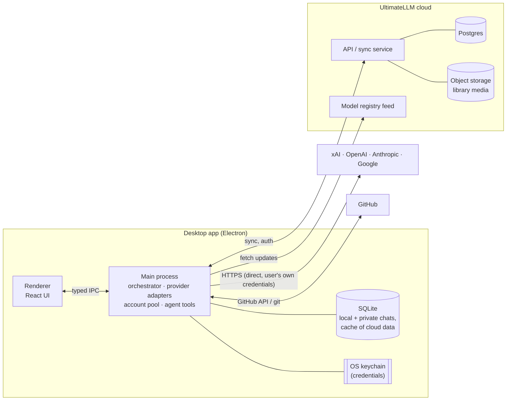

# 02 – Architecture

## High-level picture



**Key principle:** provider calls go **directly from the user's machine to the provider** using the user's own credentials. The UltimateLLM cloud never sees provider credentials or prompt traffic, except for cloud chats the user chose to sync. This keeps the backend cheap, keeps keys safe, and avoids proxying other companies' APIs.

## Tech stack

Decided in Phase 0. The reasoning for each choice is in the [decision log](decisions.md).

| Layer | Choice | Why |
| --- | --- | --- |
| Shell | **Electron 44** (Chromium 152, Node 24) | Same as the Claude/ChatGPT desktop apps. Mature auto-update, keychain, notifications. |
| Build | **electron-vite 5** (Vite 7) | Hot reload for the UI and quick restarts for the main process. Bundles everything, so the packaged app has no `node_modules`. ([D-002](decisions.md)) |
| Packaging | **electron-builder 26**: NSIS (Windows), DMG (macOS), AppImage (Linux, later) | Signing and notarization, Azure Trusted Signing, `electron-updater`. Unsigned builds until Phase 5. |
| Language | **TypeScript 6.0** everywhere | One language across main, renderer, backend and shared types. TS 7 once `typescript-eslint` supports it ([D-006](decisions.md)). |
| UI | **React 19 + Tailwind CSS 4 + shadcn/ui-style components (Radix)** | Quick path to a Claude/ChatGPT-like look. Accessible primitives. |
| UI state | **Zustand** (local UI) + **TanStack Query** (data from the main process) | Simple, light. |
| Markdown/code | `react-markdown` + Shiki, KaTeX, Mermaid (Phase 1) | Matches what users expect from AI chat apps. |
| Local DB | **SQLite via `node:sqlite`** (built into Electron's Node) + **Drizzle ORM 1.0 RC** | No native module to rebuild. FTS5 for search. Migrations generated by drizzle-kit and run at startup. ([D-003](decisions.md)) |
| Secrets | Electron **`safeStorage`** (OS keychain / DPAPI) | Credentials never touch the renderer or disk in plaintext. |
| Provider SDK | **Vercel AI SDK v7** (`@ai-sdk/openai`, `anthropic`, `google`, `xai`) | One streaming/tools/usage API, verified against all four providers ([Spike 2](spikes/02-sdk-choice.md)). |
| Validation | **Zod 4** | IPC inputs, settings, and the manager's plans (structured output). |
| Monorepo | **pnpm 10 workspaces + Turborepo** | Shared packages between desktop, backend and future mobile/web. New packages must be at least 7 days old to install ([D-007](decisions.md)). |
| Backend | **Supabase** (Postgres, Auth, Storage, Realtime) to start | Accounts, sync and file storage without building a backend from scratch. Can move to a custom service (Fastify/Hono + Postgres + S3/R2) later if needed. |
| Tests | **Vitest** (unit), **Playwright** for Electron (end-to-end), packaged-app smoke test | All run in CI on Linux, Windows and macOS. |
| Code signing | Apple Developer ID + notarization, Windows signing (Azure Trusted Signing): Phase 5 | Needed for auto-update and to avoid OS warnings. Until then macOS builds are ad-hoc signed. |

## Repository layout

Packages marked *(planned)* are created in the phase that needs them.

```
ultimatellm/
├─ apps/
│  ├─ desktop/            Electron app
│  │  ├─ src/main/        main process: window, app:// protocol, security, IPC handlers, DB
│  │  ├─ src/preload/     contextBridge: the typed, minimal API exposed to the UI (window.ull)
│  │  ├─ src/renderer/    React UI
│  │  └─ e2e/             Playwright end-to-end tests
│  └─ backend/            (planned) Supabase migrations, edge functions, registry publishing
├─ packages/
│  ├─ shared/             types, Zod schemas, IPC contract, settings definitions
│  ├─ db/                 Drizzle schema, migrations, data access (local SQLite)
│  ├─ ui/                 shared React components + design tokens (reusable for web/mobile later)
│  ├─ core/               orchestrator: triage + planning, workflow executor, workspace tools, failover
│  ├─ providers/          adapter per provider (AI SDK), error classification, model registry, mock provider
│  ├─ accounts/           encrypted keys, validation, priority lists, account health
│  ├─ registry/           model knowledge base: schema, bundled data, pricing, routing rules
│  └─ agent/              (planned) coding-agent loop + tools (fs, shell, git) + permission engine
└─ docs/
```

`core`, `providers`, `accounts` and `agent` have **no Electron dependency**. That lets them be unit-tested in plain Node and reused by a future web/mobile backend.

## Process model & security

- **Renderer** is sandboxed: `sandbox: true`, `contextIsolation: true`, `nodeIntegration: false`. It only talks to main through a typed preload API (`window.ull`, e.g. `window.ull.settings.setTheme('dark')`; streamed events come back as subscriptions).
- The packaged UI is served from **`app://ultimatellm/`** (a custom protocol, not `file://`) with a strict **Content-Security-Policy**: no inline scripts, no `eval`, no network access from the page.
- **IPC contract** (`packages/shared/src/ipc.ts`): every channel has a Zod schema. Main only accepts calls from the app's own top-level frame and validates each input before running the handler.
- Navigation away from the app, new windows and `<webview>` are blocked. `https:` links open in the default browser. Browser permissions are denied unless allow-listed.
- **Electron fuses** turn off RunAsNode, `NODE_OPTIONS`, inspector flags and loading code from outside the integrity-checked `app.asar`.
- **Main process** owns everything privileged: credentials, provider calls, DB, file system, shell, git.
- Heavy or long-running work (agent tool execution, indexing) runs in **utility processes** (`utilityProcess`) so the main thread stays responsive.
- Credentials are encrypted with `safeStorage` and stored in SQLite. They are **not synced by default** (see open question Q1).
- All agent shell/file actions go through the permission engine (see [05](05-projects-and-library.md)).

## Data model (core tables)

```
user                (cloud)  id, email, settings
provider_account             id, provider, label, auth_type(api_key|chatgpt_plan), priority,
                             spend_cap, status, cooldown_until  (+ secret ref → keychain)
usage_event                  account_id, model, input/output/reasoning tokens, cost, ts, message_id
chat                         id, kind(cloud|local|private), project_id?, title, created_at
message                      id, chat_id, role, content, status, output_mode, tokens, cost, created_at
plan                         message_id, kind(direct|workflow), summary, spec, manager, plan_mode
plan_step                    message_id, key, kind(plan|task|wrapup), title, instructions, depends_on[],
                             outputs[], provider, model, effort, account, status, report, tokens, cost, times
workspace_file               chat_id, message_id, step, path, version, content, mime, size, created_at
feedback                     message_id|step, rating, note, ts
project                      id, kind(local|cloud), name, path?, github_repo?, instructions
project_memory               project_id, content, updated_at
artifact                     id, project_id?, type(doc|image|video|audio), title, tags[]
artifact_version             artifact_id, version, storage_ref, created_by_model, created_at
```

## Where data lives

| Data | Cloud chat / project | Local chat / project | Private chat |
| --- | --- | --- | --- |
| Messages, plans, subtasks | Postgres + local SQLite cache | Local SQLite | Local SQLite only. Excluded from sync, backups and telemetry. |
| Library artifacts | Object storage + local cache | Synced to cloud by default (per R24); can be marked local-only | Not saved to cloud library unless explicitly exported |
| Provider credentials | Device keychain (optional encrypted sync later) | same | same |
| Usage/cost totals | Synced (aggregates only) | Synced (aggregates only) | Aggregates only, no content |

**Sync approach (v1):** cloud records are the source of truth. The client keeps a SQLite cache, writes through to Supabase, and listens to Realtime for changes from other devices. Conflicts are rare (one user, append-mostly data), so last-write-wins per record is good enough. Artifact edits create new versions rather than overwrite.

## Voice input

Speech-to-text goes to whichever signed-in provider offers transcription (OpenAI / Google), routed through the same account pool. A later option is local Whisper (`whisper.cpp`) for private chats.
