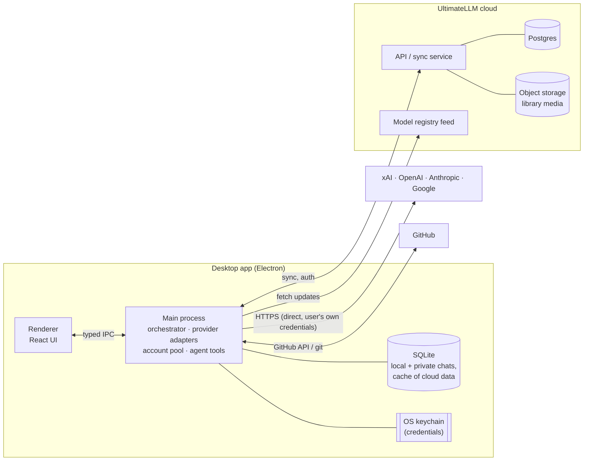

# 02 – Architecture

## High-level picture



**Key principle:** provider calls go **directly from the user's machine to the provider** using the user's own credentials. The UltimateLLM cloud never sees provider credentials or prompt traffic, except for cloud chats the user chose to sync. This keeps the backend cheap, keeps keys safe, and avoids proxying other companies' APIs.

## Tech stack (recommended)

| Layer | Choice | Why |
| --- | --- | --- |
| Shell | **Electron** | Same as Claude/ChatGPT desktop. Mature auto-update, keychain, notifications. |
| Build | **Electron Forge + Vite** | Fast dev loop, official tooling. (`electron-builder` is a fine alternative if Forge's signing/updating falls short.) |
| Language | **TypeScript everywhere** | One language across main, renderer, backend and shared types. |
| UI | **React + Tailwind + shadcn/ui (Radix)** | Quick path to a Claude/ChatGPT-like look. Accessible primitives. |
| UI state | **Zustand** (local UI) + **TanStack Query** (data) | Simple, light. |
| Markdown/code | `react-markdown` + Shiki, KaTeX, Mermaid | Matches what users expect from AI chat apps. |
| Local DB | **SQLite** via `better-sqlite3` + **Drizzle ORM** | Fast, embedded, FTS5 for search. Same schema style as the cloud DB. |
| Secrets | Electron **`safeStorage`** (OS keychain / DPAPI) | Credentials never touch the renderer or disk in plaintext. |
| Provider SDKs | Evaluate **Vercel AI SDK** as a unified base, else the official SDKs | AI SDK has xAI/OpenAI/Anthropic/Google providers with one streaming interface. Effort/thinking controls and usage headers may need provider-specific escape hatches. Decide in phase 0. |
| Validation | **Zod** | Grok bot plans are structured output validated against a schema. |
| Monorepo | **pnpm workspaces + Turborepo** | Shared packages between desktop, backend and future mobile/web. |
| Backend | **Supabase** (Postgres, Auth, Storage, Realtime) to start | Accounts, sync and file storage without building a backend from scratch. Can move to a custom service (Fastify/Hono + Postgres + S3/R2) later if needed. |
| Tests | Vitest (unit), Playwright for Electron (e2e) | |
| Packaging | Code signing: Apple Developer ID + notarization, Windows signing (Azure Trusted Signing) | Needed for auto-update and to avoid OS warnings. |

## Repository layout

```
ultimatellm/
├─ apps/
│  ├─ desktop/            Electron app
│  │  ├─ src/main/        main process: IPC handlers, orchestrator host, agent tools, DB, keychain
│  │  ├─ src/preload/     contextBridge: the typed, minimal API exposed to the UI
│  │  └─ src/renderer/    React UI
│  └─ backend/            Supabase migrations, edge functions, registry publishing
├─ packages/
│  ├─ core/               orchestrator, planner, executor, compiler (no Electron deps; testable)
│  ├─ providers/          adapter per provider + shared ProviderAdapter interface
│  ├─ accounts/           account pool, priority, failover, usage tracking
│  ├─ registry/           model knowledge base schema + bundled snapshot
│  ├─ agent/              coding-agent loop + tools (fs, shell, git) + permission engine
│  ├─ db/                 Drizzle schemas (local + cloud), migrations
│  ├─ shared/             types, Zod schemas, IPC contracts
│  └─ ui/                 shared React components (reusable for web/mobile later)
└─ docs/
```

`core`, `providers`, `accounts` and `agent` have **no Electron dependency**. That lets them be unit-tested in plain Node and reused by a future web/mobile backend.

## Process model & security

- **Renderer** is sandboxed: `contextIsolation: true`, `nodeIntegration: false`, strict CSP. It only talks to main through a typed preload API (e.g. `window.ull.chat.send(...)`, streamed events back).
- **Main process** owns everything privileged: credentials, provider calls, DB, file system, shell, git.
- Heavy or long-running work (agent tool execution, indexing) runs in **utility processes** (`utilityProcess`) so the main thread stays responsive.
- Credentials are encrypted with `safeStorage` and stored in SQLite. They are **not synced by default** (see open question Q1).
- All agent shell/file actions go through the permission engine (see [05](05-projects-and-library.md)).

## Data model (core tables)

```
user                (cloud)  id, email, settings
provider_account             id, provider, label, auth_type(api_key|oauth), priority,
                             spend_cap, status, cooldown_until  (+ secret ref → keychain)
usage_event                  account_id, model, input/output/reasoning tokens, cost, ts, message_id
chat                         id, kind(cloud|local|private), project_id?, title, created_at
message                      id, chat_id, role, content, plan_id?, mode, created_at
plan                         id, message_id, manager_model, output_mode, plan_mode, json, status
subtask                      id, plan_id, depends_on[], provider, model, effort, prompt,
                             status, output, account_id, tokens, cost, latency_ms
feedback                     message_id|subtask_id, rating, note, ts
project                      id, kind(local|cloud), name, path?, github_repo?, instructions
project_memory               project_id, content, updated_at
artifact                     id, project_id?, type(doc|image|video|audio), title, tags[]
artifact_version             artifact_id, version, storage_ref, created_by_model, created_at
```

## Where data lives

| Data | Cloud chat / project | Local chat / project | Private chat |
| --- | --- | --- | --- |
| Messages, plans, subtasks | Postgres + local SQLite cache | Local SQLite | Local SQLite only. Excluded from sync, backups and telemetry. |
| Library artifacts | Object storage + local cache | Synced to cloud by default (per R24); can be marked local-only | Not saved to cloud library unless explicitly exported |
| Provider credentials | Device keychain (optional encrypted sync later) | same | same |
| Usage/cost totals | Synced (aggregates only) | Synced (aggregates only) | Aggregates only, no content |

**Sync approach (v1):** cloud records are the source of truth. The client keeps a SQLite cache, writes through to Supabase, and listens to Realtime for changes from other devices. Conflicts are rare (one user, append-mostly data), so last-write-wins per record is good enough. Artifact edits create new versions rather than overwrite.

## Voice input

Speech-to-text goes to whichever signed-in provider offers transcription (OpenAI / Google), routed through the same account pool. A later option is local Whisper (`whisper.cpp`) for private chats.
