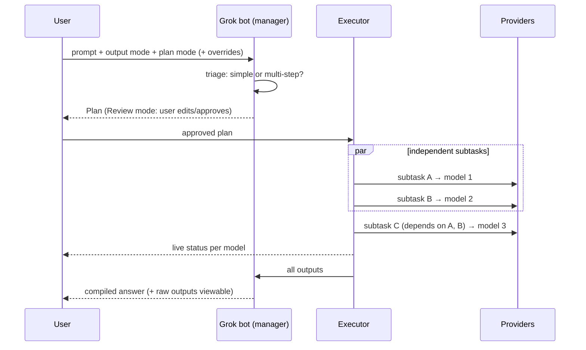

# 03 – Orchestration (Grok bot)

Grok bot is the heart of the app. It has four jobs: **plan → execute → monitor → compile**.



## 1. Triage (cost and latency guard)

Not every prompt needs splitting. Running a full plan for "what's 2+2" wastes money and time. Grok bot first classifies the prompt:

- **Direct:** one subtask, routed to one model. Planning is a single cheap call (or Grok bot answers itself if it is the best fit for the mode).
- **Orchestrated:** a multi-subtask plan.

Triage and planning should use a **fast/cheap Grok tier**. A reasoning tier is used only for complex plans or in `Best` mode.

## 2. Planning

Grok bot returns a **structured plan** (JSON, validated with Zod). If the output fails validation, it is retried once with the validation error included.

```ts
type Plan = {
  summary: string;                 // one line, shown to the user
  outputMode: "cheapest" | "balanced" | "best" | "fastest";
  subtasks: Subtask[];
  compile: { strategy: "concatenate" | "sectioned" | "stitched"; instructions: string };
  estimate: { costUsd: number; seconds: number };
};

type Subtask = {
  id: string;
  title: string;                   // e.g. "Write the SQL schema"
  prompt: string;                  // exact prompt sent to the worker model
  category: TaskCategory;          // from the registry taxonomy
  dependsOn: string[];             // ids, makes the plan a DAG
  model: { provider: Provider; id: string; effort: "none" | "low" | "medium" | "high" | "max" };
  fallbacks: ModelRef[];           // ordered alternatives if this model is unavailable
  tools: ("web_search" | "code_execution" | "image_generation" | ...)[];
  rationale: string;               // why this model, shown in Review mode
};
```

**Hard constraints are enforced in code, not trusted to the LLM.** Before a plan is accepted, the app checks that each chosen model belongs to a signed-in provider with a usable account, that the context fits, and that requested tools exist on that model. Anything that fails is swapped to the subtask's first valid fallback, or the planner is re-asked.

### Output modes

Each mode is a set of weights given to the planner and used by the code-side validator to rank fallbacks:

| Mode | Quality | Cost | Speed | Behavior |
| --- | --- | --- | --- | --- |
| Cheapest | low weight | **high** | low | Smallest model that meets the task's minimum quality bar. Low effort. Splits less. |
| Balanced | medium | medium | medium | Mid-tier models. Escalates only for hard categories (complex code, math). |
| Best | **high** | low | low | Frontier models, high effort. More verification subtasks allowed. |
| Fastest | medium | low | **high** | Low-latency models, low/no reasoning effort. Maximum parallelism. Fewer dependent steps. |

### Plan modes
- **Auto:** the plan runs immediately. It still appears in a collapsible "Plan" panel.
- **Review:** the plan card shows subtasks, models, effort, rationale and the cost/time estimate. The user can change the model or effort (dropdowns limited to available models), edit a subtask prompt, add or delete subtasks, then press **Run**.

### Overrides
The user can pin a model for the whole prompt (`@claude` mention or a composer picker) or lock it in Review mode. Pinned choices are passed to the planner as hard constraints.

## 3. Model knowledge base (registry)

Grok bot doesn't need fine-tuning. It needs **good, current data in its context** on every planning call. The registry is versioned JSON, bundled with the app and updated from a feed hosted with the backend, so new models don't need an app release.

```ts
type ModelEntry = {
  provider: Provider; id: string; displayName: string; released: string;
  status: "active" | "deprecated";
  modalities: { in: Modality[]; out: Modality[] };      // text, image, audio, video
  contextTokens: number; maxOutputTokens: number;
  effortLevels: Effort[];                               // mapped to each provider's own param
  tools: ToolKind[];
  pricing: { inputPerM: number; outputPerM: number; cachedInputPerM?: number; perImage?: number };
  speed: { ttftMs: number; tokensPerSec: number };       // measured or published
  scores: Partial<Record<TaskCategory, number>>;         // 0–100, curated from benchmarks + evals
  notes: string;                                        // short, human-written strengths/weaknesses
};

type TaskCategory =
  | "coding" | "code_review" | "debugging" | "math" | "reasoning" | "research_web"
  | "long_context_analysis" | "creative_writing" | "technical_writing" | "summarization"
  | "translation" | "data_extraction" | "vision_understanding"
  | "image_generation" | "video_generation" | "audio_generation" | "chat";
```

Only the models **the user can actually use** are put in the planner's prompt (filtered by signed-in providers), together with mode weights and the user's preferences. This keeps the prompt short and the choices valid.

**Keeping it accurate:** scores come from public benchmarks plus a small **in-house eval suite** (a fixed set of prompts per category, graded by rubric). It is re-run when new models launch. This suite is also how we test that Grok bot's routing improves over time.

## 4. Personalization

- 👍/👎 on the final answer **and** on individual subtask outputs. An optional "why" tag: wrong, too slow, too expensive, style.
- An explicit setting: preferred/avoided providers and models per category.
- These become a **preference profile** (per category: provider/model affinity scores, updated with simple decay-weighted averages). It is added to the planner prompt and applied as a tiebreaker in the code-side ranking.
- Stored with the user's cloud account so it follows them across devices. Private chats can contribute only if the user allows it.

## 5. Execution

- The executor runs the plan as a **DAG**. Each subtask starts as soon as its dependencies finish. Independent subtasks run in parallel.
- Concurrency limits apply per provider account (respects rate limits) and globally.
- Each subtask gets an account from the account pool ([04](04-providers-and-accounts.md)). On a usage-limit or account error, the pool fails over to the next account. If none is left, the executor tries the subtask's model fallbacks.
- Dependent subtasks receive their dependencies' outputs as context (trimmed or summarized if too long).
- Streaming status events go to the UI: `queued → running (tokens streaming) → done | failed | retrying(account switch)`.
- The user can **stop** the whole run or cancel/retry an individual subtask.

## 6. Compilation

Per R12, Grok bot **assembles without rewriting**:

- `concatenate`: outputs in order, with short headings. No model call. Instant and free.
- `sectioned`: Grok bot writes a short intro and transitions between sections. Worker outputs are inserted **verbatim**.
- `stitched`: only when the user asks for one integrated answer (e.g. a single essay). Grok bot merges the outputs. Flagged in the UI as "merged by Grok bot".

Every answer has a **"Sources"** panel listing which model produced which part, with the raw outputs, tokens and cost.

## 7. Manager fallback

If the xAI account(s) fail (outage, rate limit, auth):

1. Try the user's other xAI accounts (normal failover).
2. Fall back to a **backup manager**: the best available non-xAI model for planning in this order (user-configurable): Anthropic mid tier → OpenAI mid tier → Google fast tier. Planning needs strong instruction-following and reliable JSON, not frontier reasoning.
3. If nothing works, send the prompt directly to the user's default model and say that orchestration is unavailable.

The UI shows a small "Backup manager: <model>" badge while this is in effect. The xAI-account requirement (R7) applies at setup. The backup only covers temporary failures.

## 8. Cost & tokens

- **Before running:** an estimate based on the registry's pricing and expected token counts per subtask. Shown in Review mode and as a hover tooltip in Auto mode.
- **After running:** actual tokens (input / cached / output / reasoning) and cost per subtask and per message, including the manager's own calls.
- **Running totals:** per chat, per project, per account, per day/month. These feed the usage page and spend caps.
