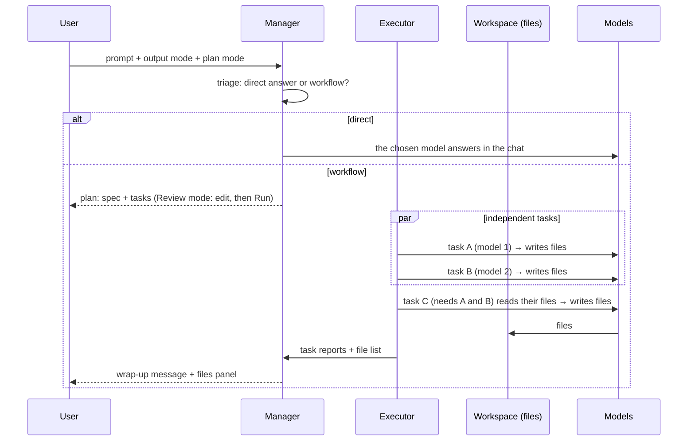

# 03 – Orchestration (the manager)

The **manager** is the heart of the app. By default it's **Grok bot** (xAI), but no provider is required: the role goes to the first provider in the user's manager order that they have an account for (see [§7](#7-choosing-the-manager)).

For every prompt the manager decides between two shapes of work:

- **Direct answer:** one model answers in the chat. The manager only picks which model and how hard it should think. Most questions, explanations and short pieces of writing go this way.
- **Workflow:** the manager writes a **shared spec**, breaks the work into **tasks**, and assigns each task to the model best suited to it. Tasks run in parallel where they can and write their results as **files** in the chat's workspace. The manager then sums up what was made.

Example: *"Create a tennis game"* could become a workflow like this:

| Task | Goes to | Why | Writes |
| --- | --- | --- | --- |
| Research top players and turn them into stat values | Grok (live search, from milestone 1c) | Knows current results | `data/players.json` |
| Create the court, player and ball graphics | Gemini (image generation, from 1c) | Makes images | `assets/*.png` |
| Write the game code | Claude | Strongest at code | `index.html`, `src/*.js` |
| Set up how the game is built and run | ChatGPT | Good at tooling and config | `README.md`, `package.json` |

The models are chosen by **capability and strength** from the model registry, not by brand. The example above is what that typically produces when the user has all four accounts. With fewer accounts, the same tasks go to whatever the user has. The user can always force a model with an `@mention`.



## 1. Triage

The manager's first decision, made in the same call as the plan:

- **Direct** when one model can handle the request well: questions, explanations, advice, a single piece of writing or code, most follow-ups. A direct answer streams in the chat like any AI app; the manager only chose the model.
- **Workflow** when the request asks to *produce something with distinct parts* that benefit from different strengths or tools: an app or game, a researched report with data, a set of documents, a site with copy and graphics.

Splitting a simple question across models makes answers slower, pricier and less coherent, so the planner is told to prefer direct answers unless parts are genuinely separable.

**No planning call** when the user pins a model with an `@mention` (`@claude`, `@gpt`, `@gemini`, `@grok`, or a model like `@opus`): that model answers directly.

## 2. Planning

The manager returns a **structured plan** (JSON validated with Zod, using each provider's structured-output mode). If the output can't be parsed, it is retried once with the error. If planning fails entirely, the prompt falls back to a direct answer from the manager's own model, with a note.

```ts
type Plan = {
  kind: "direct" | "workflow";
  summary: string;              // one line, shown to the user
  // Direct answers
  category: TaskCategory;
  model: string; effort: Effort;
  // Workflows
  spec: string;                 // the shared contract every task receives (Markdown)
  tasks: Task[];
};

type Task = {
  id: string;
  title: string;                // e.g. "Write the game code"
  instructions: string;         // what to do, referring to the spec
  category: TaskCategory;       // from the registry taxonomy
  model: string; effort: Effort;
  dependsOn: string[];          // task ids: makes the plan a DAG
  outputs: string[];            // files this task must write, from the spec
  rationale: string;            // why this model, shown in the plan card
};
```

### The shared spec

Separately written parts only fit together if they agree on the details up front. Before anything runs, the manager writes a short **spec** that every task receives:

- the goal and the deliverable (what the user will open or read),
- the **file layout**: every file, who writes it, what it contains,
- the **interfaces** between parts: function names, asset names and sizes, data formats (e.g. the fields in `players.json`),
- style and constraints (language, framework, no external dependencies, …).

Tasks must follow the spec. If a task can't, it says so in its report and the wrap-up mentions it.

### Hard constraints are enforced in code, not trusted to the LLM

Before a plan runs, the app checks it and repairs what it can:

- every model belongs to a provider with a usable account (otherwise: the best usable model for the task's category and output mode),
- effort levels exist on the chosen model (otherwise: the nearest one),
- `dependsOn` only points at earlier tasks (which also rules out cycles),
- output paths are safe relative paths, and each file is written by only one task,
- at most 8 tasks.

Each task also gets **fallback models**: the next best usable models for its category and mode.

### Choosing models: output modes

The planner gets the usable models (price, speed, context, notes) and, for each task category, the registry's recommendation for the current output mode. The same ranking (`rankModels()` in `packages/registry`) picks fallbacks and repairs invalid choices:

| Mode | Rule | Effort |
| --- | --- | --- |
| Cheapest | The cheapest model whose score for the category clears a quality bar (60; 66 for hard categories such as coding and math). | low |
| Balanced | Mid-tier models that clear a higher bar (78; 84 for hard categories), best score first. Escalates to the cheapest stronger model only when no mid-tier model clears it. | medium |
| Best | The highest score for the category. | high |
| Fastest | The quickest model that clears the quality bar. | none / lowest |

Fastest mode also asks for fewer, more parallel tasks; Cheapest asks for fewer tasks overall.

### Plan modes
- **Auto:** the plan runs immediately. It still appears as a collapsible plan in the chat.
- **Review:** a plan card shows the summary, the spec, and each task with its model, effort, files and rationale, plus a cost/time estimate. The user can edit the spec and task instructions, change models and effort (dropdowns limited to usable models), add or delete tasks, then press **Run**.

### Overrides
`@mentions` pin a provider (its model for the output mode) or a specific model, and skip planning. A mentioned model that can't be used is an error, not a silent substitution.

## 3. Model knowledge base (registry)

The manager doesn't need fine-tuning. It needs **good, current data in its context** on every planning call. The registry (`packages/registry`) is versioned JSON, bundled with the app (`packages/registry/data/registry.v1.json`). Installed apps also download the published copy of that file from the repository's `main` branch and use it when its `version` is newer, so new models and prices don't need an app release.

```ts
type ModelEntry = {
  id: string; provider: Provider; name: string;
  tier: "fast" | "balanced" | "best";
  status: "active" | "deprecated";
  aliases: string[];              // other API IDs for the same model
  mentions: string[];             // extra @mention names, e.g. "opus"
  manager?: "fast" | "strong";    // the models a provider uses when it manages
  contextTokens: number; maxOutputTokens?: number;
  efforts: Effort[];              // levels we can set; empty = provider default
  pricing: PricePeriod[];         // $/1M tokens; dated periods, long-context and cached-input rates
  speed: { tokensPerSec: number; latencyMs: number };
  scores: Record<TaskCategory, number>;   // 0–100
  notes: string;                  // short, human-written strengths/weaknesses
  // From milestone 1c: capabilities (web_search, image_generation, …) and image models
};

type TaskCategory =
  | "chat" | "coding" | "code_review" | "debugging" | "math" | "reasoning"
  | "creative_writing" | "technical_writing" | "summarization" | "translation"
  | "data_extraction" | "long_context_analysis";
  // Research, vision and media categories arrive with tools (1c).
```

Only the models **the user can actually use** are put in the planner's prompt. This keeps the prompt short and the choices valid.

**Keeping it accurate:** v1 scores combine public leaderboards (the Artificial Analysis index, October 2026) with each provider's guidance. They are rough priors. A small **in-house eval suite** (a fixed set of prompts per category, graded by rubric) will replace them and is re-run when new models launch. The same suite tests how well each provider performs as manager.

## 4. Personalization

- 👍/👎 on the final answer **and** on individual task results. An optional "why" tag: wrong, too slow, too expensive, style.
- An explicit setting: preferred/avoided providers and models per category.
- These become a **preference profile** (per category: provider/model affinity scores, updated with simple decay-weighted averages). It is added to the planner prompt and applied as a tiebreaker in the code-side ranking.
- Stored with the user's cloud account so it follows them across devices. Private chats can contribute only if the user allows it.

## 5. Execution

- The executor runs the plan as a **DAG**. Each task starts as soon as its dependencies finish; independent tasks run in parallel (up to 4 at a time).
- Each task runs as a short **tool loop** with the chosen model. It receives the spec, its instructions, the list of files in the workspace and the files its dependencies wrote. Its tools are `list_files`, `read_file` and `write_file` (from 1c also the provider's web search and image generation). It ends with a short report.
- Each task gets an account from the account pool ([04](04-providers-and-accounts.md)). On a usage-limit or account error, the pool fails over to the next account; when none is left, the task moves to its fallback models.
- A task that fails after every fallback is marked failed. Tasks that depend on it are skipped; the others still run. A task that already streamed output isn't silently restarted.
- Status events stream to the UI: `queued → running → done | failed | skipped`, with the model, account and any account switch.
- The user can stop the whole run at any time. Files written so far are kept.

## 6. The workspace and the wrap-up

**Workspace.** Every chat has a workspace of files. Tasks write into it, and later prompts in the same chat see and change the same files ("make the ball faster" edits `src/game.js`). Every write is kept as a version, labelled with the task and model that wrote it. The files panel shows the current files; they can be viewed and exported to a folder. Files live in the local database for now; local projects ([05](05-projects-and-library.md)) later point the same tools at a real folder.

**Wrap-up.** Per R12, the manager presents results **without rewriting them**: the files are the deliverable. After the tasks finish, the manager writes the chat message: what was made, which file is which, how to use it, and anything that failed or deviated from the spec. A direct answer needs no wrap-up; the model's answer is the message.

Every message has a **Sources** view listing who did what: the planning call, each task (model, account, effort, tokens, cost, time, files written, report) and the wrap-up.

From milestone 1d an **integration** step goes further: it assembles the project, opens web results (HTML/JS games and apps) in a sandboxed preview, and feeds errors back for one automatic fix round.

## 7. Choosing the manager

No provider is required. One list decides both who manages and who takes over:

- **Manager order:** default **xAI (Grok bot) → Anthropic (Claude) → OpenAI (ChatGPT) → Google (Gemini)**. The user can reorder it in settings (`orchestration.managerPriority`).
- **Selection:** the first provider in the order with a **usable account** (active, under its spend cap, not rate-limited) is the manager. Implemented in `rankManagers()` in `packages/shared/src/orchestration.ts`.
- **Models:** the registry marks each provider's `fast` manager model (planning, wrap-ups) and `strong` one (planning in Best mode).
- **Accounts:** manager calls go through that provider's account pool like any other request, so its priority list and failover apply ([04](04-providers-and-accounts.md)).
- **Fallback:** if all of the manager provider's accounts fail (outage, limits, auth), the next provider in the order takes over for that prompt. Planning needs strong instruction-following and reliable JSON, which all four providers' current models offer.
- **When planning fails** for another reason (e.g. unparseable output twice), the manager's own model answers directly and the message says planning was unavailable.

The UI always shows who is managing, e.g. "Manager: Claude".

**To verify in milestone 1e:** structured output through a ChatGPT-plan account, given its request restrictions ([Spike 1](spikes/01-subscription-auth.md)).

## 8. Cost & tokens

- **Before running:** an estimate based on the registry's pricing and expected token counts per task. Shown on the Review plan card.
- **After running:** actual tokens (input / cached / output / reasoning) and cost per task and per message, including the manager's own calls. Costs are at list prices; free tiers and plan credits aren't visible to the app.
- **Running totals:** per chat, per project, per account, per day/month. These feed the usage page and spend caps (milestone 1e).
