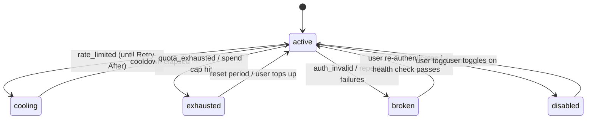

# 04 – Providers & accounts

## Provider adapter interface

Each provider is wrapped behind one interface so the orchestrator never deals with provider-specific details.

```ts
interface ProviderAdapter {
  id: "xai" | "openai" | "anthropic" | "google";
  authTypes: ("api_key" | "oauth")[];

  validate(cred: Credential): Promise<AccountInfo>;          // on sign-in, plus periodic health checks
  listModels(cred: Credential): Promise<string[]>;           // cross-checked against the registry

  generate(req: GenerateRequest, cred: Credential): AsyncIterable<StreamEvent>;
  generateImage?(req: ImageRequest, cred: Credential): Promise<ImageResult>;
  generateVideo?(req: VideoRequest, cred: Credential): Promise<JobHandle>;
  generateAudio?(req: AudioRequest, cred: Credential): Promise<AudioResult>;
  transcribe?(req: AudioInput, cred: Credential): Promise<string>;

  mapEffort(effort: Effort, model: string): ProviderParams;   // our effort scale → provider param
  mapTools(tools: ToolKind[], model: string): ProviderParams; // our tool list → built-in tools
  readUsage(resp: RawResponse): UsageSnapshot;               // tokens + rate-limit headers
  classifyError(err: unknown): ErrorClass;
}

type ErrorClass =
  | "rate_limited"      // short-term limit → cooldown this account (honor Retry-After), try next
  | "quota_exhausted"   // credit/billing/plan limit → mark account exhausted until reset, try next
  | "auth_invalid"      // revoked/expired → mark account broken, notify user, try next
  | "model_unavailable" // try the subtask's model fallback, not another account
  | "bad_request"       // our bug or content issue → don't fail over, surface the error
  | "server_error";     // retry with backoff on the same account (max 2), then try next
```

**Effort mapping:** each provider exposes reasoning differently (reasoning-effort settings, thinking token budgets, thinking levels). The registry stores which levels each model supports. `mapEffort` converts our 5-level scale to each provider's setting.

**Built-in tools (R17):** web search, code execution and image generation use each provider's server-side tools wherever available. The app runs its own tools only for local project work (file system, shell, git). See [05](05-projects-and-library.md).

## Account pool



**Choosing an account for a request:** take the provider's accounts in the user's priority order and pick the first that is `active`, under its spend cap, and has room under its concurrency limit. If the chosen one fails with `rate_limited`, `quota_exhausted`, `auth_invalid` or exhausted `server_error` retries, mark it, pick the next, and resend. The user sees "switched to <account label>" on that subtask's status bar.

**Parallel load:** for parallel subtasks, the pool still fills accounts in priority order. It moves to account #2 only when #1 is at its concurrency limit. This honors "use this one first".

**Health checks:** a cheap validation call on app start and every few hours for `broken`/`exhausted` accounts, so they recover on their own.

## Usage limits (R6)

What can be shown depends on the auth type:

| Signal | API key | Plan sign-in (if possible) |
| --- | --- | --- |
| Tokens & cost we've spent | ✅ tracked locally from response usage | ✅ tokens; cost N/A |
| Short-term rate-limit headroom | ✅ from rate-limit response headers (where provided) | depends on provider |
| Remaining prepaid credit / billing | Mostly no. Usually needs admin keys or isn't exposed. | Plan usage meters, if the provider exposes them |
| User-set spend cap | ✅ enforced by the app | N/A |

The usage page shows, per account: status, priority, tokens/cost today/this month, the cap and progress bar, last error, and rate-limit headroom when known.

## Sign-in flows

- **API key (baseline):** paste the key → `validate()` → label it → place it in the priority list. Each provider's console page is linked in the UI.
- **OAuth / plan sign-in (preferred where legitimate):** depends on Spike 1 in [07](07-open-questions.md). If a provider offers an official third-party OAuth for model access, the adapter uses a browser-based OAuth flow with PKCE (system browser + loopback/custom-scheme redirect) and stores refresh tokens in the keychain.
- **xAI required:** onboarding cannot be finished without one working xAI account (R7).

## Adding providers later

New providers (Mistral, DeepSeek, Meta/Llama hosts, OpenRouter, local Ollama/LM Studio) only need a new adapter and registry entries. Nothing changes in the orchestrator. Local models fit naturally with **Private** chats.
