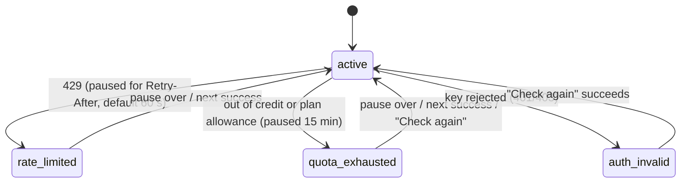

# 04 – Providers & accounts

## Provider adapter interface

Each provider is wrapped behind one interface so the orchestrator never deals with provider-specific details.

```ts
interface ProviderAdapter {
  id: "xai" | "openai" | "anthropic" | "google";
  authTypes: AuthType[];   // see "Sign-in flows" below

  validate(cred: Credential): Promise<AccountInfo>;          // on sign-in, plus periodic health checks
  listModels(cred: Credential): Promise<string[]>;           // cross-checked against the registry

  generate(req: GenerateRequest, cred: Credential): AsyncIterable<StreamEvent>;
  generateImage?(req: ImageRequest, cred: Credential): Promise<ImageResult>;
  generateVideo?(req: VideoRequest, cred: Credential): Promise<JobHandle>;
  generateAudio?(req: AudioRequest, cred: Credential): Promise<AudioResult>;
  transcribe?(req: AudioInput, cred: Credential): Promise<string>;

  mapEffort(effort: Effort, model: string): ProviderParams;   // our effort scale → provider param
  mapTools(tools: ToolKind[], model: string): ProviderParams; // our tool list → built-in tools
  readUsage(resp: RawResponse): UsageSnapshot;               // tokens + rate-limit headers
  classifyError(err: unknown): ErrorClass;
}

type ErrorClass =
  | "rate_limited"      // short-term limit → cooldown this account (honor Retry-After), try next
  | "quota_exhausted"   // credit/billing/plan limit → mark account exhausted until reset, try next
  | "auth_invalid"      // revoked/expired → mark account broken, notify user, try next
  | "model_unavailable" // try the subtask's model fallback, not another account
  | "bad_request"       // our bug or content issue → don't fail over, surface the error
  | "server_error";     // retry with backoff on the same account (max 2), then try next
```

**Effort mapping:** each provider exposes reasoning differently (reasoning-effort settings, thinking token budgets, thinking levels). The registry stores which levels each model supports. `mapEffort` converts our 5-level scale to each provider's setting.

**Built-in tools (R17):** web search, code execution and image generation use each provider's server-side tools wherever available. The app runs its own tools only for local project work (file system, shell, git). See [05](05-projects-and-library.md).

## Account pool



Implemented in `packages/accounts` (milestone 1a); failover across accounts and models is in `packages/core` (`withFailover`). Spend caps and a user "disable" toggle come in milestone 1e.

**Choosing an account for a request:** take the provider's accounts in the user's priority order and pick the first that is `active` and can use the model (per the model list the provider reported when the key was checked). If it fails:
- `rate_limited` or `auth_invalid`: the account is marked (see above) and the next account is tried.
- `quota_exhausted` or `model_unavailable`: often specific to one model (free tiers have per-model quotas), so that model is skipped on that account for 15 minutes and the next account is tried. An account that runs out on two or more models in one request is paused.
- `server_error` or network trouble: the next account is tried.
- `bad_request`, unreadable output or anything unknown: the next model is tried.

The user sees "switched after an error" on that step's status bar. Spend caps and per-account concurrency limits come with milestone 1e.

**Parallel load:** for parallel subtasks, the pool still fills accounts in priority order. It moves to account #2 only when #1 is at its concurrency limit. This honors "use this one first".

**Health checks:** a cheap validation call on app start and every few hours for `broken`/`exhausted` accounts, so they recover on their own.

## Usage limits (R6)

What can be shown depends on the auth type:

| Signal | API key | Plan sign-in (if possible) |
| --- | --- | --- |
| Tokens & cost we've spent | ✅ tracked locally from response usage | ✅ tokens; cost N/A |
| Short-term rate-limit headroom | ✅ from rate-limit response headers (where provided) | depends on provider |
| Remaining prepaid credit / billing | Mostly no. Usually needs admin keys or isn't exposed. | Plan usage meters, if the provider exposes them |
| User-set spend cap | ✅ enforced by the app | N/A |

The usage page shows, per account: status, priority, tokens/cost today/this month, the cap and progress bar, last error, and rate-limit headroom when known.

## Sign-in flows

Decided by [Spike 1](spikes/01-subscription-auth.md):

```ts
type AuthType =
  | "api_key"             // all providers
  | "chatgpt_plan"        // OpenAI: Sign in with ChatGPT, usage billed to the user's Plus/Pro plan
  | "claude_code_bridge"  // Anthropic, Phase 2 option: runs the user's own signed-in Claude Code
  | "xai_oauth";          // xAI, only if xAI opens SuperGrok OAuth to apps like ours
```

| Provider | v1 sign-in options | Notes |
| --- | --- | --- |
| OpenAI | **Continue with ChatGPT** (plan usage) · API key | ChatGPT-plan accounts can't generate images or run Code Interpreter. The planner treats those as account capabilities. Available because UltimateLLM is an open-source, locally run app (Apache-2.0, [D-008](decisions.md)). |
| Anthropic | API key | Claude Max includes $100–200/month of API credits for a linked Console org. Onboarding explains this. |
| Google | API key (AI Studio) | AI Pro/Ultra include $10/$100 per month of Cloud credits usable for the Gemini API. There's also a free tier. |
| xAI | API key (optional; makes Grok bot the manager) | SuperGrok doesn't include API access. |

- **API key:** paste the key → `validate()` → label it → place it in the priority list. Each provider's console page is linked in the UI.
- **ChatGPT plan:** system browser + OAuth 2.0 PKCE with a loopback redirect (`http://127.0.0.1:<port>/auth/callback`) and dynamic client registration on first sign-in. Tokens (1-hour access, rotating refresh) are encrypted with `safeStorage`. The UI shows "Using ChatGPT plan" with a *Manage usage* link.
- **Plan → pay-per-token fallback is opt-in.** When a plan account hits its limit, the account pool moves on to an API-key account only if the user allowed it for that provider. Otherwise those requests pause.
- **No provider is required:** any one working account is enough to start. The first provider in the manager order with a usable account becomes the manager ([03 §7](03-orchestration.md#7-choosing-the-manager)). Google's free Gemini API tier is the cheapest way to try the app.

## Adding providers later

New providers (Mistral, DeepSeek, Meta/Llama hosts, OpenRouter, local Ollama/LM Studio) only need a new adapter and registry entries. Nothing changes in the orchestrator. Local models fit naturally with **Private** chats.
